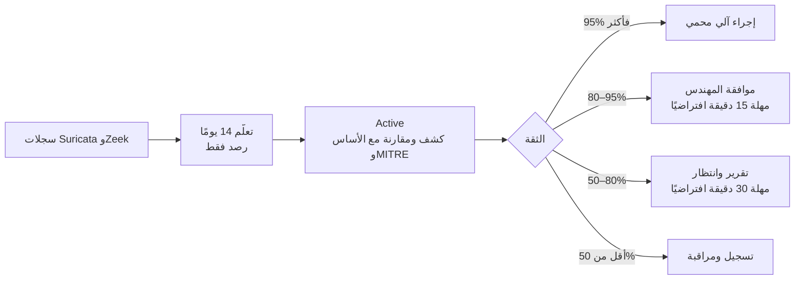

# تشغيل Sentinel وتجربته

Sentinel يقرأ سجلات الحساسات، يحفظ نمط الشبكة خلال 14 يوم رصد، ثم يصنّف الحوادث ويقترح الاستجابة. **التشغيل الافتراضي محاكاة**: لا يغيّر قواعد الشبكة.



## 1. شغّله محليًا

من جذر المشروع على Linux أو macOS:

```bash
python3 -m venv .venv
. .venv/bin/activate
pip install -e '.[ops-ui,dev]'
cp config.example.yaml config.yaml
mkdir -p capture data
export SENTINEL_OPS_UI_TOKEN='ضع-هنا-رمزًا-طويلًا-عشوائيًا'
python -m sentinel --config config.yaml run --capture-dir capture --ui
```

على Windows PowerShell استخدم `py -m venv .venv` ثم `.\.venv\Scripts\python.exe -m pip install -e ".[ops-ui,dev]"`، و`Copy-Item config.example.yaml config.yaml`، ثم `New-Item -ItemType Directory -Force capture,data | Out-Null`. اضبط الرمز بـ `$env:SENTINEL_OPS_UI_TOKEN='...'`، ثم شغّل `.\.venv\Scripts\python.exe -m sentinel --config config.yaml run --capture-dir capture --ui`.

افتح **[http://127.0.0.1:8080/login](http://127.0.0.1:8080/login)** وأدخل الرمز. رمز الدخول يبقى في جلسة التبويبة؛ إغلاق التبويبة ينهيها. صفحة `/` وواجهات البيانات ترفض الطلبات بلا رمز.

## 2. Docker وLinux VM

```bash
cp .env.example .env
# ضع SENTINEL_OPS_UI_TOKEN في .env، ولا ترفع الملف إلى Git
docker compose config --quiet
docker compose up --build -d
docker compose ps
docker compose logs --tail=50 sentinel
```

على VM ضع المشروع في `/opt/sentinel-app` وثبّت Docker Engine وCompose. الواجهة مربوطة على loopback. افتح نفقًا من جهازك: `ssh -L 8080:127.0.0.1:8080 user@VM_HOST`، ثم افتح رابط الدخول محليًا. للتشغيل عند إقلاع VM: `sudo cp infra/sentinel.service /etc/systemd/system/ && sudo systemctl daemon-reload && sudo systemctl enable --now sentinel`. راجع `sudo systemctl status sentinel` و`docker compose ps`.

## 3. وصّل السجلات

- **Suricata**: ملف `eve.json` داخل مجلد `--capture-dir` أو `/logs` في الحاوية.
- **Zeek**: الملفات `conn.log` و`dns.log` و`ssl.log` و`notice.log` في المجلد نفسه. راجع صفحة **المصادر** للتأكد من التحديث وعدم وجود أخطاء قراءة.
- في Linux مع منفذ SPAN/TAP، ضع `CAPTURE_IFACE=eth1` و`COMPOSE_PROFILES=capture` في `.env` بعد تغيير `eth1` لواجهة النسخ الفعلية، ثم `docker compose up -d`. لا تضع IP إداريًا على واجهة النسخ.
- بديل SIEM: اضبط قسم `siem.inbound` في `config.yaml` أو `config.container.yaml` على ملف التنبيهات المدعوم؛ الإعدادات الأساسية في المثال. لا تفترض أن وجود ملف قديم يعني تدفقًا حيًا.
- عدّل `site.protected_ips` ليشمل IP الإدارة والبوابة وDNS والخوادم الحرجة، و`site.critical_assets` و`monitored_vlans` و`capture_interfaces` و`placement` بحسب شبكتك.
- `.env`: `SENTINEL_OPS_UI_TOKEN` للدخول؛ `SENTINEL_LLM_API` اختياري للدماغ؛ `NVD_API_KEY` اختياري لإثراء CVE؛ `SENTINEL_SOAR_TOKEN` فقط إذا وصلّت SOAR؛ `CAPTURE_IFACE` و`COMPOSE_PROFILES` للحساسات. الأسرار لا تُكتب داخل YAML.

الإعدادات التي تحفظها من الواجهة تُخزن في `ui-settings.yaml` بجانب `audit.sqlite`، وتُراجع عند الإقلاع التالي. صفحة **التعلّم** تعرض الملف المحفوظ وتسمح بالمد أو التحويل اليدوي؛ التحويل لا يلغي وضع المحاكاة.

## 4. اختبر بأمان

أبقِ شارة **dry-run** ظاهرة. هذه الأوامر تضيف **سجلات اصطناعية فقط** ولا ترسل حزمًا للشبكة. بعد بدء daemon:

```bash
python -m sentinel.simulation scan --capture-dir capture
python -m sentinel.simulation brute --capture-dir capture
python -m sentinel.simulation ddos --capture-dir capture
python -m sentinel.simulation anomaly --capture-dir capture
```

في Docker استبدل بداية كل أمر بـ `docker compose exec sentinel python -m sentinel.simulation` واستخدم `--capture-dir /logs`. يظهر المسح كـ `T1046`، والتخمين `T1110`، وحجب الخدمة `T1498.001` في **الحوادث** مع الثقة والقرار. شغّل المحاكاة كل نوع على حدة وانتظر ثواني ثم حدّث الصفحة. قد تختار سياسة القرار فئة مختلفة بحسب الثقة والحماية. أثناء التعلّم ستظهر توصيات وإجراءات محجوبة، ولن يُنفذ حظر فعلي. اختبار الشذوذ يحتاج **14 يومًا حقيقيًا من الأساس** أو ملف تجربة معزول مكتمل؛ ضغطة Active وحدها لا تختلق خط أساس.

للاختبارات الآلية: `python -m pytest -q`. للتحقق من السجل: `python -m sentinel ctl audit verify data/audit.sqlite` (داخل Docker استخدم `/var/lib/sentinel/audit.sqlite`).

## 5. يوم المهندس المناوب

1. راجع شارات الوضع والمصادر والتنبيهات، ثم **الأحداث الأخيرة** و**الحوادث**.
2. افتح الحادثة للتفاصيل والدليل وMITRE. راجع **الموافقات** قبل المهلة؛ اعتمد أو ارفض أو عدّل الإجراء أو سجّل أنك ستتعامل يدويًا.
3. راقب **الإجراءات** للنتيجة الفعلية أو سبب الحجب، واستخدم **إرجاع** للإجراء النشط عند الحاجة.
4. افتح **التدقيق** للتحقق من سلسلة SHA-256 وتصدير CSV/JSON. أنشئ تقريرًا من **التقارير** ونزّله.

## 6. قبل إيقاف المحاكاة

تحقق من تغطية الحساسات وجودة سجلات 14 يومًا، قائمة الحماية، عتبات القرار والمهل، قنوات الإشعار، صلاحيات الجدار الناري، اختبار الرجوع وTTL، ومراجعة مهندس للحوادث الاصطناعية. رفع `autonomy_level` قرار منفصل. زر إيقاف المحاكاة يتطلب تأكيدًا، ويرفض الحفظ إذا مرحلة التعلّم لم تنتهِ أو مصدر غير سليم أو قائمة الحماية فارغة؛ **الحفظ لا يطبق التغيير حتى إعادة التشغيل**. ابدأ بشبكة اختبار معزولة.

## 7. أكثر 10 مشكلات شيوعًا

| المشكلة | الإجراء |
|---|---|
| صفحة الدخول لا تفتح | تأكد من `docker compose ps` أو عملية `sentinel run --ui` والمنفذ 8080. |
| رمز الدخول مرفوض | طابق `SENTINEL_OPS_UI_TOKEN` في بيئة العملية؛ أعد تشغيلها بعد تغييره. |
| المصادر متوقفة | تحقق من أسماء ومسارات الملفات داخل `--capture-dir` أو `/logs`. |
| لا تظهر حادثة بعد المحاكاة | تأكد من شارة dry-run وحداثة `live-health.json` وانتظر دورة الرصد. |
| لا يظهر شذوذ | يلزم أساس 14 يومًا مكتملًا ووضع Active ومنافذ جديدة. |
| إجراء محجوب | اقرأ سبب الحجب في **الإجراءات**؛ التعلّم وL0 وdry-run تمنع التنفيذ. |
| لا إشعارات | اضبط `notifiers` ومتغيرات البيئة، ثم أعد التشغيل؛ راجع شارة القنوات. |
| MITRE دون وصف | الكتالوج لم يُزامَن بعد؛ افحص الاتصال أو شغّل `sentinel ctl intel sync-attack`. |
| الإعدادات لا تسري | الحفظ يكتب `ui-settings.yaml`، ثم يلزم إعادة تشغيل daemon. |
| Docker لا يبدأ | شغّل `docker compose config --quiet` ثم `docker compose logs sentinel` وراجع مسار ملف التهيئة. |
